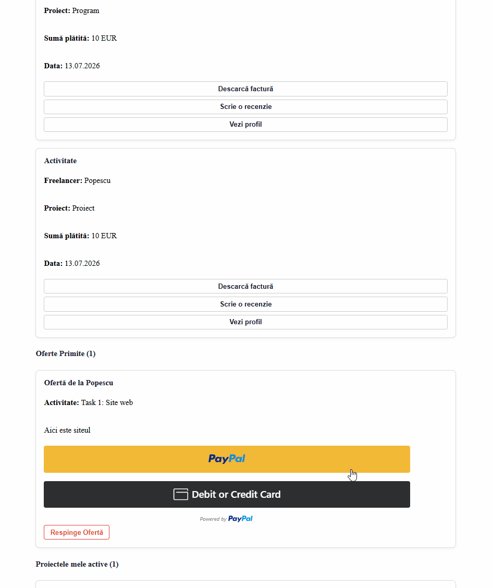

# FreelancerApp



A freelancing marketplace web app where clients can post projects and hire freelancers, and freelancers can apply, work on projects and get paid through PayPal. The frontend and backend are separate: React on the client side, ASP.NET Core on the server, with a PostgreSQL database.

## About

The app supports several user roles (client, freelancer, expert and admin), each with its own dashboard. A client can post a project, receive offers from freelancers, hire someone and release the payment once the work is delivered. Freelancers can apply to projects, upload documents/certificates for validation, and receive reviews after finishing a job. There is also a dispute system for cases where the client and the freelancer disagree, plus PDF invoice generation for completed payments.

## Key Features

- Registration and login with multiple roles (client, freelancer, expert, admin), using JWT authentication
- Clients can post projects and tasks
- Freelancers send offers, which the client can accept or reject
- Hiring, work delivery, payment release and disputes
- Dispute resolution panel where an expert decides whether the client is refunded or the freelancer is paid
- Integrated PayPal payments
- PDF invoice generation (QuestPDF)
- Certificates uploaded by freelancers and validated by an expert/admin
- Reviews between client and freelancer
- Embedding-based project recommendations (EmbeddingService), powered by a local model served through Ollama

## Tech Stack

**Backend**

- ASP.NET Core (.NET 9)
- Entity Framework Core
- PostgreSQL
- JWT authentication
- QuestPDF for invoice generation
- Ollama (local embedding model for project recommendations)

**Frontend**

- React 19
- Vite
- React Router
- SweetAlert2
- PayPal React SDK

## Project Structure

- `FreelancerApp.Client/` - React app (pages in `src/Pagini`, styles in `src/CSS`)
- `FreelancerApp.Server/` - ASP.NET Core API (`Controllers/`, `Models/`, `Uploads/` for uploaded files)
- `Licenta.sql` - SQL script that populates the database
- `FreelancerApp.sln` - Visual Studio solution linking the client and the server

## Prerequisites

- [.NET 9 SDK](https://dotnet.microsoft.com/download)
- [Node.js](https://nodejs.org) (LTS) and npm
- [PostgreSQL](https://www.postgresql.org/download/)
- [Ollama](https://ollama.com)
- A PayPal developer (sandbox) account

## Getting Started

1. Create an empty PostgreSQL database named `Licenta`.
2. Run the `Licenta.sql` script to populate it with the required data.
3. Install Ollama and pull the embedding model:

```
   ollama pull nomic-embed-text
```

Ollama runs on `http://localhost:11434` by default. 4. Configure the server:

- Copy `FreelancerApp.Server/.env.example` to `FreelancerApp.Server/.env` and fill in your values (database connection, PayPal credentials, JWT secret).
- If you use a different Ollama URL or model, update it in the same place.

5. Start the backend:

```
   cd FreelancerApp.Server
   dotnet run
```

6. Start the frontend:

```
   cd FreelancerApp.Client
   npm install
   npm run dev
```

7. Open `http://localhost:5173` in your browser.
